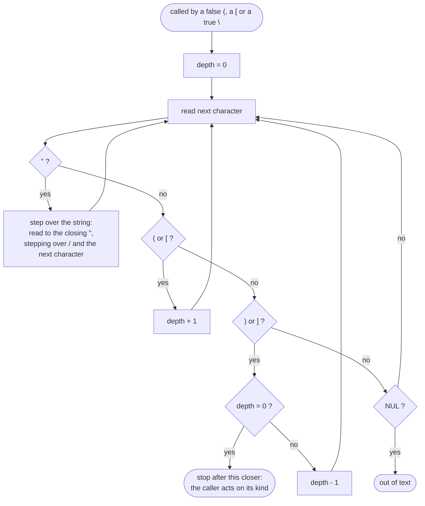

# B8Script Spec

Nov 24, 2026 · @ROB8S

B8Script is a postfix stack language for 64 KB 8-bit computers. Every instruction is one ASCII character, and the source text runs directly, with no compile step.

**Contents**

- [Execution model](#execution-model)
- [Literals](#literals)
- [Character reference](#character-reference)
- [Control flow](#control-flow)
- [Memory, heap and machine code](#memory-heap-and-machine-code)
- [Errors and checked builds](#errors-and-checked-builds)
- [The break key](#the-break-key)
- [The console](#the-console)
- [Idioms](#idioms)
- [Tips and gotchas](#tips-and-gotchas)
- [Examples](#examples)
- [Implementing B8Script](#implementing-b8script)
- [Environments](#environments)
- [Programs](#programs)
- [Appendix A: Z80](#appendix-a-z80)
- [Appendix B: 8080](#appendix-b-8080)
- [Appendix C: 6502](#appendix-c-6502)
- [Appendix D: 6809](#appendix-d-6809)
- [Appendix E: B8SIC](#appendix-e-b8sic)
- [Appendix F: the B8Script TTL computer](#appendix-f-the-b8script-ttl-computer)
- [Appendix G: Windows (32-bit x86)](#appendix-g-windows-32-bit-x86)

## Execution model

A program is a byte string read left to right until a NUL byte. Each character acts at once on the stacks or the reading position.

| Item | Rule |
|---|---|
| Cell | 16 bits. Cells are untyped bit patterns: the same cell is a signed number (−32768 to 32767), an unsigned number or an address, depending on what reads it. Arithmetic wraps |
| Truth | 0 is false, anything else true. Comparisons return −1 or 0 |
| Memory | Byte-addressed 64 KB. Cells in memory are little-endian, unaligned |
| Data stack | Operands and results. TOS is the top, NOS the one below. It holds at least 64 cells |
| Return stack | Return addresses, block starts and values parked with `{`, one entry each. It holds at least 64 entries |
| Ignored | Control characters (01h–1Fh), space and DEL (7Fh) |
| Reserved | 80h–FFh outside strings. Programs must not use them there. Unchecked builds ignore them; checked builds stop with `X`. Inside strings they are allowed and printed as they are; what they look like is up to the terminal |
| End | NUL. The end of a loaded file counts as NUL |

Operands follow written order: `a b -` is a − b. Effects are written `( before -- after )`, top on the right; `R:` marks the return stack.

**Addresses point into the loaded program.** The interpreter loads the source text into memory and runs it in place, so the reading position is an ordinary memory address. String addresses from `"`, word addresses, block starts and return addresses all point into that loaded text. A program can read its own text with `@` and `,`, and even rewrite it with `!` and `.`.

**A program behaves the same everywhere.** The same program gives the same results on every implementation and in every environment (runner, prompt or editor), except where this spec says a value is undefined or implementation-defined. The things a program must not rely on are collected under [Don't rely on](#dont-rely-on).

[↑ Back to top](#b8script-spec)

## Literals

**Numbers** are decimal. A digit starts a number, and the interpreter reads digits until a non-digit, then pushes the value: `12 34` is two numbers, `12+` adds 12. Values beyond 16 bits wrap: 40000 reads as −25536, and 61440 is the same cell as −4096 (F000h).

**Negative numbers.** `-` followed directly by a digit is a negative literal: `-5`. Any other `-` subtracts. So `5-3` pushes 5 and −3, while `5- 3` subtracts then pushes 3.

**Characters** have no literal; push the code (`65` for A).

**Hex** has no literal either. See *Bits and hex* under [Idioms](#idioms) for three ways to write hex constants.

**Strings.** `"` pushes the address of the text after it and skips to the closing `"`. The text stays inline and nothing is copied. `$` prints it: `"Hi"$`.

Inside a string, `/` and the character after it are an escape. Escapes are decoded only when `$` prints the string.

| Escape | Gives | Examples |
|---|---|---|
| `/@` to `/_` | Control codes 00h–1Fh: the character with bit 6 cleared | `/M` CR, `/J` LF, `/[` ESC |
| `/` before 00h–3Fh | That character | `/"` = `"`, `//` = `/`, `/?` = `?` |
| `/DEL` | `?` (DEL with bit 6 cleared) | |
| `/a` to `/z` | That variable's value, printed as `#` prints it: signed decimal, no space. It is read when the string is printed | `"Score: /s"$` |
| `/{` | Clear the screen; the cursor goes to the top left | |
| `/}` | Clear from the cursor to the end of the line | |
| `/\|` | Show the cursor | |
| `` /` `` | Hide the cursor | |
| `/~` | Move the cursor to a row and column, both counted from 0, taken from the data stack under the string's address: `r c"/~*"$` is `( row col addr -- )` | `5 10"/~*"$` |
| `/` before 80h–FFh | That character with bit 6 cleared | |

Each `/~` in a string takes two more cells, in order: `1 2 3 4"/~a/~b"$` prints `a` at row 3, column 4, and `b` at row 1, column 2. The console escapes (`/{` `/}` `/|` `` /` `` `/~`) are described under [The console](#the-console).

A skip steps over `/` and the character after it, so `/"` puts a quote in a string without ending it. The same rule means a `/` just before the closing quote escapes the quote: a string that ends in `/` must write it as `//`. This applies to comments too, since a comment is a string.

[↑ Back to top](#b8script-spec)

## Character reference

Characters marked **†** have a catch, explained under *Marked characters* below the tables.

**Arithmetic and logic**

| Char | Meaning | Effect |
|---|---|---|
| `0`–`9` | Decimal number | `( -- n )` |
| `-` + digit **†** | Negative number | `( -- n )` |
| `+` `-` **†** `*` | Add, subtract, multiply | `( a b -- n )` |
| `/` **†** | Divide, truncating toward zero, and leave the remainder on top (it takes a's sign). Dividing by 2 or −2 must be fast | `( a b -- q r )` |
| `&` `\|` `^` | Bitwise AND, OR, XOR | `( a b -- n )` |
| `~` | Bitwise NOT | `( a -- ~a )` |
| `<` `=` `>` | Signed compare | `( a b -- flag )` |

**Stack**

| Char | Meaning | Effect |
|---|---|---|
| `:` | Dup | `( a -- a a )` |
| `;` | Drop | `( a -- )` |
| `%` | Swap | `( a b -- b a )` |
| `{` **†** | Data to return stack | `( a -- )` R:`( -- a )` |
| `}` **†** | Return stack to data | `( -- a )` R:`( a -- )` |

**Storage**

| Char | Meaning | Effect |
|---|---|---|
| `a`–`z` **†** | Address of that variable | `( -- addr )` |
| `@` `!` | Fetch, store cell | `( addr -- n )` `( n addr -- )` |
| `,` `.` | Fetch (0–255), store byte | `( addr -- c )` `( c addr -- )` |
| `_` **†** | Move the heap top by n (signed) and push the old top | `( n -- addr )` |

**Flow control**

| Char | Meaning | Effect |
|---|---|---|
| `(` `)` | Block start, block end | `( flag -- )` |
| `\` **†** | Break if true | `( flag -- )` |
| `[` **†** | Define: `[X` a word, `[x` a variable, `[ ` an anonymous block | `[ `: `( -- addr )` |
| `]` **†** | Return |  |
| `A`–`Z` **†** | Call that word |  |

**Console**

| Char | Meaning | Effect |
|---|---|---|
| `"` **†** | Address of the inline string | `( -- addr )` |
| `$` **†** | Print string, decoding escapes | `( addr -- )` |
| `'` | Emit a character (the low byte) | `( c -- )` |
| `#` | Print signed decimal, with no space after | `( n -- )` |
| `?` **†** | n > 0: wait up to about n ms for a key and return it, or 0 if none came. 0: wait until a key arrives. No echo. Negative: read a line (see `?` below) | `( n -- c )` or `( -n -- addr )` |

**Machine code**

| Char | Meaning | Effect |
|---|---|---|
| `` ` `` + hex digit **†** | Hex loader | `( addr -- addr' )` |
| `` ` `` + other **†** | Execute machine code | `( addr -- )` |

**Marked characters**

- `-` **Two jobs.** Directly before a digit it starts a negative number; anywhere else it subtracts. To subtract a number, put a space after the `-`: `5- 3`, not `5-3`.
- `/` **Truncates toward zero and leaves the remainder.** `-7 2/` leaves −3 and −1: the quotient (not −4), then the remainder on top with the dividend's sign. Use `/;` for the quotient alone and `/%;` for the remainder alone. Dividing by 0 is unsafe: an unchecked build leaves two cells of no meaning (the stack stays balanced), a checked build stops with `Z`. Dividing by 2 or −2 is a shift inside the interpreter, so `2/` is fast halving; it is still division, not a shift right (see *Bits and hex* under Idioms).
- `{` `}` **Share the return stack with blocks.** Inside a block, the top entry is the block's start, so keep them paired unless you mean a trick.
- `a`–`z` **Start undefined.** Store before you read.
- `_` **Signed, and it does not negate.** A positive count allocates, a negative count releases, and `0_` just reads the heap top. One call moves the top by at most 32767 bytes; allocate more with two calls. Negate with `-1*`. See *Heap* below.
- `\` **Exits the innermost block or word.** At `)` it continues after the block; at `]` it returns. Outside any block or word, it ends the program.
- `[` **Looks at the next character.** An uppercase letter defines that word; a lowercase letter stores the body's address in that variable; a space pushes the body's address (an anonymous block). Either way it then skips to the matching `]`. Any other character is unsafe: a checked build stops with `W`. Executing `]` jumps to whatever address is on top of the return stack.
- `A`–`Z` **Start undefined.** Calling a word that was never defined is unsafe: a checked build stops with `U`.
- `"` **The address points into the program text.** An unclosed string runs on into memory (a checked build stops with `Q`).
- `$` **Can take more than the address.** Each `/~` in the string takes a row and a column from under it: `r c"/~text"$` is `( row col addr -- )`. With too few cells that is a data stack underflow (a checked build stops with `s`). The `/a` to `/z` escapes read their variables as the string is printed, not when it was written.
- `?` **Takes a count.** n? (n > 0) waits up to about n ms and returns 0 if no key came, so 1? is a quick check for real-time programs and 0? waits for a key. The timing need only be approximate. -n? reads a line of at most n characters with echo and returns its address. Every implementation guarantees:
  - the text ends with CR (13), which is stored;
  - at most n characters are stored before the CR; an implementation may cap n, but at no less than 127;
  - Backspace removes the last character;
  - CR ends the line;
  - the line lasts until the next -n?.

  The rest is implementation-defined, so that a platform's own line reader (a monitor's routine, say) can be used, as long as a key held by the break check comes first in the line (see [The break key](#the-break-key)): how Backspace is echoed, what Delete and other control keys do, whether a full line ends by itself, and whether the CR is echoed. -1? reads one character confirmed with CR. A key that arrives while no ? is running may be lost on machines without a UART; a one-byte UART keeps only the newest.
- `` ` `` **Two jobs, chosen by the next character.** A hex digit (`0`–`9`, `A`–`F` or `a`–`f`) loads bytes; anything else executes. Words `A`–`F` and variables `a`–`f` right after a grave count as hex, so to execute when one follows, put a space after the grave: `` x@` b@ ``.

Besides digits, four characters look at the text after them: `"`, `-`, `[` and `` ` ``.

[↑ Back to top](#b8script-spec)

## Control flow

One pair of round brackets gives every structure. The closing flag decides whether the block repeats.

| Char | True | False |
|---|---|---|
| `(` | Push the address after `(` to the return stack, enter | Skip to the matching `)` |
| `)` | Jump to the address on top of the return stack, keep it | Pop it, continue |
| `\` | Skip to the next `)` or `]` at this level: `)` pops the block start, `]` returns. With no closer, the program ends | Nothing |

| Structure | Form |
|---|---|
| If | `flag( body 0)` |
| Do-while | `1( body flag)` |
| While, test in the middle | `1( test 0=\ body 1)` |
| If-else | `:{( then 0)}0=( else 0)` |
| Guard clause | `[W cond\ rest]` |
| Halt | `1\` at the top level |

**Definitions.** `[X body]` stores the address after `X` in word X's cell, then skips to the matching `]`. `X` pushes the address after the letter onto the return stack and jumps to the body; executing `]` pops an address and jumps to it. A definition must run before its word is called, and running it again redefines the word. Recursion works.

`[x body]` does the same, but stores the address in variable x: call it with `x@X`, using the eval word `[X{]` (see Idioms). `[ body]` pushes the address instead, so code can be handed to a word on the stack: `[ 7#]X`.

### How skipping works

Three things skip text without running it: a false `(`, a `[` (after reading the character that follows it) and a true `\`. All three use the same routine, the **skipper**. It reads forward from where it was called and stops at the first closer that belongs to the level it started at. It does not run anything, and it looks at only five characters: `(` `[` `)` `]` `"`.

1. Start with a depth of 0.
2. Read the next character.
3. If it is `"`, step over the whole string: read on to the closing `"`, stepping over `/` and the character after it each time. Go to 2.
4. If it is `(` or `[`, add 1 to the depth. Go to 2.
5. If it is `)` or `]`:
   - at depth 0, this is the closer: stop, just after it;
   - otherwise subtract 1 from the depth and go to 2.
6. If it is NUL, the text has run out: stop (see below).
7. Anything else is passed over. Go to 2.



What the caller does with the closer:

| Called by | Closer found at depth 0 | Then |
|---|---|---|
| False `(` | `)` | Carry on after it |
| `[` | `]` | Carry on after it (the body has been passed over, its address stored or pushed) |
| True `\` | `)` | Pop the block start, carry on after it: the block is left |
| True `\` | `]` | Return: pop an address and jump to it |
| False `(` or `[` | the other kind, or NUL | Unsafe: a checked build stops with `N` |
| True `\` | NUL | The program ends (this is how `1\` halts at the top level) |

Two consequences are worth remembering:

- **The two kinds are counted together.** For the skipper `(` and `[` are both "open", and `)` and `]` both "close". It never checks that they pair up by kind; that is the programmer's job (see the next paragraph).
- **Only brackets and quotes matter.** Numbers, letters, other punctuation, and the digits read by the hex loader are passed over, and a hex load never contains a bracket or quote, so the skipper can never be misled by them. Brackets inside strings never count, which is why `"("` and `")"` are safe in skipped code. A `/` just before the closing quote escapes it, so the string goes on: write `//` to end a string with a slash.

An example. Here a false `(` skips from just after itself:

```text
0( "(" [A 1#] 2# ")/"" ) 3#
```

| Text | What the skipper does | Depth |
|---|---|---|
| `"("` | Steps over the string; the `(` inside doesn't count | 0 |
| `[` | Opener | 1 |
| `A 1#` | Passed over | 1 |
| `]` | Closer, not at depth 0 | 0 |
| `2#` | Passed over | 0 |
| `")/""` | Steps over the string; `/"` is an escaped quote, so the string ends at the second `"` | 0 |
| `)` | Closer at depth 0: stop | — |

Then `3#` runs and prints 3. Nothing else printed, and word A was never defined, because a skip runs nothing.

**Brackets must balance.** Any text that may be skipped must balance by the skipper's count, and each opener must close with its own kind: `(` with `)`, `[` with `]`. Mixed kinds are unsafe. They balance for the skipper but run differently, and nothing useful comes of it. A checked build stops with `N` when a skip from `(` or `[` reaches NUL or reaches a closer of the wrong kind at its own level. A `\` that finds no closer still ends the program, as `1\` does.

**A skip may be remembered.** The text of a running program doesn't change, so an implementation may remember where a skip from each place ended, and the next time skip there at once (the Z80's `QUICK` and speed builds do: see [Speed](#speed)). A program that changes its own text while it runs may then be skipped by the old text: that is unsafe.

**The return stack is exposed.** It holds plain 16-bit addresses and values. `{` and `}` need not be balanced: `)` and `]` act on whatever is on top. That makes goto, eval and tail calls possible (see Idioms).

[↑ Back to top](#b8script-spec)

## Memory, heap and machine code

**Variables.** `a`–`z` are one cell each: `5x!` stores, `x@` fetches. Their starting values are undefined, so store before you read.

**Heap.** `_` moves the heap top by a signed count and pushes the old top. The heap starts just past the program text.

| Use | Code |
|---|---|
| Allocate n bytes | `n_` leaves the address of the block |
| Read the heap top | `0_` |
| Mark | `0_m!` |
| Release back to the mark | `m@0_-_;` |

Releasing works because the count is the difference between the mark and the current top, which is negative. A block larger than 32767 bytes takes two calls. Growing the heap past its limit, or releasing it below the program's end, is a heap collision: unsafe, and a checked build stops with `H`. The limit is implementation-defined (see the appendices).

**The grave (`` ` ``)** does two jobs, chosen by the next character.

| Next character | Action | Effect |
|---|---|---|
| `0`–`9`, `A`–`F` or `a`–`f` | **Hex loader.** Reads digit pairs (mixed case freely) until any other character and stores them as bytes from addr. Then it writes the platform's RET byte and leaves the address of that RET. An odd last digit is consumed and dropped: `41A` stores 41h, and the A never runs as a word call. On a platform that cannot run machine code, this is still the way to put binary data, zero bytes included, into a program: strings hold text, the hex loader holds everything else | `( addr -- addr' )` |
| Anything else | **Execute.** Calls the machine code at addr as a subroutine. Consumes nothing after the grave | `( addr -- )` |

Because a load leaves the address of its RET, the next load overwrites it, so code can be built over several lines: `` 16_:x! `3E2A `3C ; `` Allocate one byte more than the code for the RET. A load never contains `(`, `)`, `[`, `]` or `"`, so skips pass over it safely.

**The hex loader and machine code are never checked.** The grave is how a program extends itself, including patching the OS or the interpreter, so a checked build does not range-check the loader's stores or what the code does. Making machine code behave is entirely the programmer's job.

**Machine-code contract.** Every platform defines, in its appendix: how the code is entered and returns, the RET byte the loader writes, how the code reaches the data stack, which registers and memory it must keep, and any interpreter routines it may call.

[↑ Back to top](#b8script-spec)

## Errors and checked builds

B8Script comes in two kinds of build. An **unchecked** build checks nothing, for the smallest size and best speed on tiny machines; the programmer is responsible for correct code. A **checked** build is for writing and testing programs: it catches the mistakes below and reports them. A correct program runs the same on both.

| Category | Includes |
|---|---|
| Required | Everything in this spec, for programs that stay inside it |
| Implementation-defined | Stack sizes beyond the 64 data cells and 64 return-stack entries every build has, heap start and limit, memory layout, starting values of variables and words, how often the break key is polled, the -n? details listed under `?`, system addresses, the machine-code contract, and which environments a build offers |
| Unsafe (anything may happen in an unchecked build) | Data or return stack underflow or overflow, heap collision, stores outside the program's space, changing the program's own text while it runs, calling an undefined word, unclosed strings, printing an address with no closing quote, `[` not followed by a letter or space, reserved bytes outside strings, dividing by zero, unbalanced or mismatched brackets, and anything machine code does |

### What a checked build adds

**At startup:**
- Every word cell points at an internal stop, so calling an undefined word reports `U`.
- Every variable is set to 0.
- Both stacks start empty.

**It stops with an error on:** every item in the Unsafe row above except machine code, using the codes below.

**It never checks:** the hex loader and machine code, reads with `@` and `,` (reading anywhere is harmless on these machines, and programs read ROM and I/O), arithmetic overflow (cells are untyped, so neither signed nor unsigned overflow can be flagged without breaking address arithmetic and the wraps programs rely on), and deliberately unbalanced `{` `}`.

**What it costs:** a bigger, slower interpreter. Stack overruns are tested once per character, so they are caught up to one character late, and the place reported can be one character past the cause.

**Don't treat a checked run as proof.** A checked build zeros variables, and an unchecked build does not. A program that reads a variable before storing to it can work on one and fail on the other. See [Don't rely on](#dont-rely-on).

### Error codes

| Code | Meaning |
|---|---|
| `S` / `s` | Data stack overflow / underflow |
| `R` / `r` | Return stack overflow / underflow |
| `H` | Heap past its limit, or released below the program's end |
| `O` | Store with `!` or `.` outside the program's space |
| `U` | Undefined word |
| `Q` | Missing closing quote: an unclosed string, or `$` running into NUL |
| `W` | `[` not followed by a letter or a space |
| `X` | Reserved byte (80h–FFh) outside a string |
| `Z` | Divide by zero |
| `N` | Unbalanced or mismatched brackets |
| `B` | Break key |

"The program's space" is implementation-defined. It must include the program text, the heap, and the word and variable cells, up to the heap limit, and exclude the interpreter's code and stacks. Memory above the heap top but below the limit counts as the program's, because programs such as Tiny BASIC keep data there without allocating it.

### The error report

```
Err X @ 4,16
D:3: 1 2 42
R:1
```

- The report starts with CR LF, so it never lands in the middle of the program's output.
- **Line 1:** `Err`, the code, `@`, then the line and column of the character that failed, both counted from 1. A line typed at a prompt or editor is line 0. Values up to 32767 are guaranteed; a build may print up to 65535. For `U` the place is the call; for `N` it is the opener where the skip started.
- **Line 2:** the data stack as it was when the error hit: `D:`, the depth and a colon, then up to the top 8 values, each after a space, bottom to top, so the top is last. More than 8 are shown as `…` and the top 8. For a `Q` from `$` the top is the string's address as `$` got it, not how far it had printed, over whatever cells its `/~` escapes left.
- **Line 3:** `R:` and the return stack's depth.
- The report goes to the console, or the platform's error channel where it has one, never into a program's redirected output.

**After an error or a break,** a one-shot build returns to the OS or monitor. A build with a prompt or editor returns there, with both stacks cleared and words and variables kept.

**No report at a normal end.** A program that ends normally prints nothing extra, so its output can be piped. To catch values leaked on the stack, use the sentinel idiom under *Debugging* in [Idioms](#idioms).

[↑ Back to top](#b8script-spec)

## The break key

Every build, checked or not, stops a running program on Ctrl-C (03h).

- The key is polled at the true `)` loop-back and at every word call, which catches every endless loop, including the goto idiom (a word call). Endless recursion overflows the return stack anyway. An implementation may poll only every so often, for speed, as long as it polls at least once every 256 of those points.
- A poll that reads a key other than Ctrl-C holds it for the next `?`, and a newer key replaces the held one. A program never sees Ctrl-C.
- A checked build reports `B` with the place, which shows where an endless loop was spinning. What an unchecked build prints is implementation-defined.
- An implementation may let a program turn the break key off, through a system address given in its appendix, so that the program reads Ctrl-C as an ordinary key (03h). Even then, Ctrl-C pressed twice in quick succession always breaks, so a runaway program can always be stopped.

**Implementation note: host stacks.** Where a B8Script stack is the CPU's own stack (the data stack on the Z80 and 8080, page 1 on the 6502), the interpreter saves the host's stack pointer on entry and restores it on every stop (normal end, error or break) before returning, or leaves by a path that doesn't need it, such as CP/M's warm boot. Polls and checks happen between characters, so a stop never cuts into an OS or monitor call. Interrupt handlers that push onto the same stack need headroom below the deepest point the data stack can reach; the guard band used by the stack checks provides it.

[↑ Back to top](#b8script-spec)

## The console

Output is a stream of bytes: `'`, `$` and `#` write to it, and a line ends with CR LF (`13'10'`, or `/M/J` in a string). Input is raw bytes from `?`. What special keys (arrows, function keys) send is implementation-defined; on an ANSI terminal the arrows send ESC `[` and a letter.

**Control codes.** These act on the cursor rather than print:

| Code | Does |
|---|---|
| CR (0Dh) | Cursor to the start of the line |
| LF (0Ah) | Cursor down one line; on the bottom line the screen scrolls up |
| BS (08h) | Cursor left one place, without erasing |
| BEL (07h) | A beep, or nothing |

What the other control codes do (TAB and ESC among them) is implementation-defined: a machine may show them as glyphs. So is what happens after a character is written in the last column: the cursor may wrap to the next line or stay. Programs that draw to the edge of the screen should place the cursor themselves.

**Screen control** is done with the console escapes of `$`:

| Escape | Does |
|---|---|
| `/{` | Clear the screen and put the cursor at the top left, row 0, column 0 |
| `/}` | Clear from the cursor to the end of its line. The cursor stays where it is |
| `/~` | `( row col addr -- )` Move the cursor to that row and column, counted from 0 |
| `/\|` | Show the cursor |
| `` /` `` | Hide the cursor |

```text
"/{"$ 0 30"/~Hello"$ 2 0"/~Score: /s/}"$
```

- **Hiding the cursor.** A program that hides the cursor must show it again before it ends, or the cursor stays hidden after it. After a break or an error the program can't, so an environment that goes back to a prompt or editor should show the cursor again itself.
- **Rows and columns** run from 0 to one less than the screen's height and width. The cursor's place after `/~` with a row or column off the screen is undefined.
- **How a build does it** is up to the build, and its appendix says. The existing interpreters have a build switch, `ANSI`:
  - `ANSI = 1` sends ANSI (VT100) sequences: ESC `[H` ESC `[J` for `/{`, ESC `[K` for `/}`, ESC `[?25h` and ESC `[?25l` for `/|` and `` /` ``, and ESC `[` row+1 `;` col+1 `H` for `/~`.
  - `ANSI = 0` calls four routines of the machine's own instead: clear the screen, clear to the end of the line, cursor on or off, and cursor to a row and column. Each appendix gives their interface.
  - The generic builds default to `ANSI = 0`; the CP/M builds always send ANSI; the Windows builds send ANSI, which the console understands in the mode they set (Appendix G).
- **Screen size** is implementation-defined and given in the appendix; 80 × 24 is the usual. Programs that assume a size should say so.
- **More than this** (colours, reverse video, scrolling regions) has no escape. A program can still send a terminal's own sequences, with `/[` or `27'`, but they then work only on that kind of terminal. Keep them optional.

Because a program's screen control is in the escapes and not in a terminal's codes, the same program draws the same screen on every console that a build supports.

[↑ Back to top](#b8script-spec)

## Idioms

Every idiom here runs as shown in the reference interpreter. A word in this section is free for you to rename; the letters are only what the examples use.

**Stack**

| Name | Code | Effect |
|---|---|---|
| over | `{:}%` | `( a b -- a b a )` |
| rot | `{%}%` | `( a b c -- b c a )` |
| -rot | `%{%}` | `( a b c -- c a b )` |
| nip | `%;` | `( a b -- b )` |
| tuck | `:{%}` | `( a b -- b a b )` |
| 2dup | `{:}%{:}%` | `( a b -- a b a b )` |
| 2drop | `;;` | `( a b -- )` |
| Copy parked value | `}:{` | Like Forth's R@ |

**Arithmetic**

| Name | Code | Effect |
|---|---|---|
| Negate | `-1*` |  |
| Absolute value | `:0<(-1*0)` |  |
| Sign | `:0<%0>-` | −1, 0 or 1 |
| Min | `{:}%{:}%>(%0);` | `( a b -- min )` |
| Max | `{:}%{:}%<(%0);` | `( a b -- max )` |
| Quotient | `/;` | `( a b -- q )` |
| Remainder | `/%;` | `( a b -- r )`; takes a's sign |
| Modulo word | `[M/%;]` | `( n d -- n mod d )` |
| Double | `:+` | Faster than `2*` everywhere |
| Halve (toward zero) | `2/;` | Fast everywhere |
| Increment variable | `[I:@1+%!]` | `xI` adds 1 to x |
| Flag to 1/0 | `0=1+` |  |
| Branchless select | `flag n&` | n if true, else 0 |
| Logical not of a flag | `0=` | Same as `~` on a flag; also right on any value |

**Bits and hex**

| Name | Code | Effect |
|---|---|---|
| Bitwise NOT | `~` or `-1^` |  |
| Set, clear, test bits | `m\|`, `m~&`, `m&` |  |
| Shift left | `:+` | Repeat for more places |
| Arithmetic shift right | `2/:0<&+` | Rounds down: −7 gives −4 |
| Logical shift right | `2/:0<&+32767&` | FFFFh gives 7FFFh, 8000h gives 4000h |
| Low byte, high byte | `255&`, `256/;255&` |  |
| Hex digit (0–15) | `[D:9>7&+48+']` | Prints one digit |
| Print a cell in hex | `[H:-4096&4096/;15&D:3840&256/;D:240&16/;D15&D]` | Uses D; always four digits |
| Hex constant, from text | `[P0%1(:,32\|48-:9>(39- 0):-16&\{%}%:+:+:+:++%1+1);;]` | `"F000"P` pushes F000h; stops at the first non-hex character |
| Hex from the keyboard | `-8?P` | Uses P |
| Hex constant, by bytes | `3_h!` once, then `` h@:`3412;@ `` | Pushes 1234h, with no text to parse |

The shift-right idioms work because `/` leaves the remainder with the dividend's sign: adding a negative remainder turns truncation into rounding down. In D the flag `9>` is all ones, so `7&` adds 7 for A–F with no branch. H masks each nibble in place and divides it down. For the top nibble the division gives −8 to −1 on negative cells, which is why it is masked again with `15&`. P folds case with `32|`, turns `a`–`f` into 10–15 by subtracting 39 more, and stops when the value has any bit outside 0–15 (`-16&`). Parsing costs time, so in a loop keep the value in a variable. In the by-bytes form, bytes are written little-endian and the third byte absorbs the RET; it reaches any bit pattern, such as 8000h (`` `0080 ``).

**Control**

Countdown, with the counter on the stack:

```text
10 1( :# 1-: );
```

Continue: `skip\` ends this pass early when skip is true, and the loop goes on.

```text
1(
  1( part  skip\  rest 0)
cond)
```

Return from inside a loop: record the flag as you break, then test it after the closer.

```text
[W 0q!
   1( ...  cond:q!\  ... 1)
   q@\
   ...after the loop...
]
```

Quit on q:

```text
1( 1?113=\
   ...frame...
1)
```

Switch, short. Every case is tested, so bodies must leave the stack alone:

```text
v :1=( one   0)
  :2=( two   0)
  :3=( three 0)
;
```

Switch, fast, with a default:

```text
v 1(
  :1=:( %; one   0)\
  :2=:( %; two   0)\
  :3=:( %; three 0)\
  ;        other
0)
```

In the fast switch, a match drops the value, runs its body, then breaks past the remaining cases without testing them.

**Words as values.** Executing `]` pops an address and jumps to it, so these small words work:

| Word | Code | Use |
|---|---|---|
| Eval | `[X{]` | `"1 2+#]"X` runs the string; it ends with `]` to return |
| Function in a variable | `[f 7#]` then `f@X` | Defines the body straight into f |
| Anonymous block | `[ 7#]X` | Pushes code to hand to a word |
| Function from a string | `"7#]"f!` then `f@X` | Code built or chosen at run time |
| Here | `[L}:{]` | Pushes the address just after `L` |
| Goto | `[G};{]` | `L x! ... x@:G` loops back to the `x!` |
| Tail call | `f@G` | Jumps to f without returning here |
| Continue | `}:{G` | Restarts the current block |
| Exit caller | `[E};]` | Returns from the word that called E |

These assume you know your nesting depth: inside a block, the top of the return stack is the block start, not a return address. Brackets inside an eval string are invisible to the skipper, because they are inside a string. A string run with X may therefore hold brackets that look unbalanced, as long as it ends with `]` and leaves the return stack as its caller expects.

**Memory**

| Name | Code |
|---|---|
| Allocate | `n_a!` |
| Mark the heap | `0_m!` |
| Release to the mark | `m@0_-_;` |
| Clear n bytes at a | `0i! 1( 0a@i@+. i@1+:i! n@<)` |
| Array cell i | `a@i@:++` (cell address), then `@` or `!` |

**Input and output**

| Name | Code |
|---|---|
| Comment | `"any text";` |
| New line | `13'10'`, or `/M/J` inside a string |
| Print a variable in the text | `"You have /g gold and /h hit points./M/J"$` (the values as `#` prints them) |
| Wait for a key | `0?` |
| Random seed from key timing | `0r! [K0 1(;r@1+r!1?:0=)]` |
| Read a number | `[N0v!1(0?:48<\48-:#v@10*+v!1);v@]` |
| Read a line | `-72?a!` (the text at a ends with CR, 13) |
| Run a typed line | `[X{] -72?:{1(:,13=\1+1)93%.}X` (writes `]` over the CR, then runs it) |

**Screen** (the console escapes; see [The console](#the-console))

| Name | Code | Effect |
|---|---|---|
| Clear the screen | `"/{"$` | Clears it and puts the cursor at the top left |
| Clear to the end of the line | `"/}"$` | The cursor stays put |
| Cursor to row, column | `r c"/~"$` | Both from 0: `0 0"/~"$` is the top left |
| Print at a place | `5 10"/~Hello"$` | The text starts at row 5, column 10 |
| A status line | `0 0"/~Score /s  Lives /l/}"$` | Writes over the last one: `/}` clears what is left of it |
| Hide the cursor, show it again | ``"/`"$`` first, `"/\|"$` before the program ends | A game that redraws looks steadier with the cursor hidden |
| Cursor word | `[Y"/~"$]` | `( row col -- )`: `5 10Y`, for a program that places the cursor from the stack often |

**Debugging**

| Name | Code |
|---|---|
| Stack-leak sentinel | `12345` first, then `12345=0=("Stack leak"$0)` last |
| Trace a value | `:#" "$` |
| Mark a place | `"@3"$` |

If anything leaked, the top of the stack at the end isn't the sentinel. Add it while debugging and take it out before the program goes into a pipe.

[↑ Back to top](#b8script-spec)

## Tips and gotchas

- **Subtract before a number needs a space.** `5- 3` subtracts; `5-3` pushes −3. It applies after any operator: `7*- 48` multiplies, subtracts, then pushes 48, but `7*-48` multiplies, then pushes −48.
- **Watch `-` before `0)`.** `39-0)` is 39, then −0, then a close: write `39- 0)`.
- **Store before you read.** Variables start with garbage. Seed a random counter with `0r!`.
- **Prefer the stack to variables inside reusable words.** A word that stores into `n` or `d` clobbers any caller using them. The stack-only modulo `M` avoids this.
- **Keep `{` and `}` paired inside a block** unless you mean a return-stack trick: `)` jumps to whatever is on top.
- **Loop instead of recursing forever.** Each call grows the return stack; use a block or a tail call (`G`). A portable program stays within 64 return-stack entries and 64 data cells, the least every build holds: a word call, a block entered and a value parked with `{` each take an entry.
- **Mask to make flags arithmetic.** True is all ones, so `flag 7&` gives 7 or 0 with no branch: `[D:9>7&+48+']` turns a nibble into a hex digit.
- **Break with a value.** `cond:q!\` stores the flag and breaks in one step; test `q@\` after the closer to leave several levels.
- **Build machine code in pieces.** Save the start with `:` or `{` before the first load, and drop the final address with `;`.
- **Take both results of `/` when you need both.** `i@40/ x! y!` splits a cell index into column and row with one division.
- **Double with `:+`, halve with `2/;`.** Both are fast on every implementation; a multiply or divide by any other number runs the full routine.
- **Spaces and line breaks cost time where they run.** Each one is read and dispatched like a command, every time that spot runs, so keep hot loops tight and comments (a string dropped with `;`) out of them. A stripper can remove comments and whitespace from a finished program, keeping only the spaces that separate (`12 34`, `5- 3`, a grave before a hex letter). The repository's `b8strip.py` keeps a comment whose text starts with `!`, for a note the stripped program should keep: `"! K tests Break key.";`.
- **Keep constants that run hot in variables.** A long number literal is read digit by digit every time it runs; `m@` is one fetch.
- **Use `0?` to wait for a key and `-n?` for typed text,** which it echoes and edits for you.
- **Time real-time programs with the wait, not with a count of tiny waits.** Make each frame one `n?` with n about the frame you want (`20?` for 50 frames a second), act on the key if one came, and count frames for slower events such as gravity. A frame then lasts about n ms on every machine. A loop of `1?` with a large count to make a second runs at a different speed on every machine: each pass also costs the time its own code takes to run, which differs from machine to machine, and on some hosts the shortest wait is far longer than 1 ms (15.6 ms on Windows without a high-resolution timer). Keep each frame's work short, and remember that a key ends the wait early, so a frame with a key in it is shorter.
- **`1?` is a quick look for a key**, for checking a break key in a long computation, not a clock. Look every few hundred steps rather than every step, as each look costs up to a millisecond.
- **Reading addresses.** `#` prints signed, so an address above 7FFFh prints as a negative number: F000h prints as −4096. A decimal literal wraps, so `61440` and `-4096` are the same address. Every appendix lists its addresses in hex, unsigned and signed.
- **Slashes in strings.** Write `//` for a slash. A slash before a lowercase letter prints a variable, so `"Again (y/n)? "` prints `y` and then variable n's value: write `"Again (y//n)? "`, and `"n//s//e//w"` for `n/s/e/w`.
- **The variable escape is for plain variables.** `/x` prints the cell of variable x, read at the moment the string is printed, the same as `x@#`. It can't print an expression, a cell of an array or a value on the stack: print those with `#` between two strings. A string that is printed later than it is built, or copied elsewhere and printed from there, prints the variable's value at that later time.
- **Several `/~` in one string.** Each `/~` takes a row and a column, under the string's address and in that order. Several in one string take them pair by pair, the first pair nearest the address.
- **Develop on a checked build, run on an unchecked one.** Then test once on the unchecked build too, for the reasons under Don't rely on.
- **System values live in the appendices.** Heap limit, free memory, the break-off address and similar values are per build. A program that uses them is tied to that build.

### Don't rely on

These differ between builds or environments, so a portable program must not depend on them:

- the starting values of variables and words (a checked build zeros variables and makes undefined words stop; an unchecked build leaves whatever was in memory);
- the data stack carrying over from one prompt line to the next;
- keys typed while a program runs, other than through the held key;
- how -n? echoes and treats keys other than Backspace and CR;
- the result of dividing by 0;
- what happens after the last column, what control codes other than CR, LF, BS and BEL do, the screen's size, where the cursor goes for a row or column off the screen, and what a terminal's own sequences (sent with `/[` or `27'`) do;
- memory layout, the heap limit, and either stack holding more than 64 (data cells, or return-stack entries: a word call, a block entered and a value parked with `{` take one each).

[↑ Back to top](#b8script-spec)

## Examples

Every program here runs as shown in the reference interpreter. Programs that need modulo start by defining `M`.

| Program | Chars | Code |
|---|---|---|
| Hello | 20 | `"Hello, world!/M/J"$` |
| 1 to 10 | 28 | `1i! 1( i@# " "$ i@1+:i! 11<)` |
| Factorial of 7 | 21 | `[F :1>( :1-F* 0)] 7F#` |
| Fibonacci to 28657 | 39 | `0a!1b!1(a@#" "$b@20000>\b@:a@+b!a!1)b@#` |
| Sierpinski, 32 × 32 | 65 | `0y!1(0x!1(x@y@&0=("*"$0)x@y@&(" "$0)x@1+:x!32<)"/M/J"$y@1+:y!32<)` |
| Collatz from 27 | 59 | `[M/%;]27n!1(n@#" "$n@2M:{(n@3*1+n!0)}0=(n@2/;n!0)n@1=0=)n@#` |
| 10 × 10 times table | 72 | `1r!1(1c!1(r@c@*:10<(" "$0):100<(" "$0)#" "$c@1+:c!11<)"/M/J"$r@1+:r!11<)` |
| Primes under 1000 | 73 | `[M/%;]2n!1(1p!2d!1(d@:*n@>\n@d@M0=(0p!0)d@1+d!1)p@(n@#" "$0)n@1+:n!1000<)` |
| FizzBuzz 1–100 | 78 | `[M/%;]1i!1(0f!i@3M0=("Fizz"$1f!0)i@5M0=("Buzz"$1f!0)f@0=(i@#0)" "$i@1+:i!101<)` |

**Guess the number.** The computer picks 1–99 and answers higher or lower.

```plain
[M/%;]
0r! [K 0 1( ; r@1+ 100M r! 1? :0=)]
[N 0v! 1( K :48<\ 48- :# v@10*+v! 1) ; v@]
"Guess my number from 1 to 99. Press a key to start./M/J"$ K;
r@99M1+s! 0t!
1( "/M/JYour guess: "$ N g! t@1+t!
   g@s@<( "  higher"$ 0)
   g@s@>( "  lower"$ 0)
   g@s@=0=)
"/M/JGot it in /t tries!/M/J"$
```

**Machine code with the grave** (Z80 and 8080). Load once, call as often as needed. Each load needs one byte more than its code, for the RET.

Double TOS: `pop de` (the return address), `pop hl`, `add hl,hl`, `push hl`, `push de`. Prints 42:

```text
8_:d! `D1E129E5D5 ;
21 d@` #
```

The grave right after `d@` is followed by a space, so it executes. Conway's Life and Star Trek are under Programs at the end.

[↑ Back to top](#b8script-spec)

## Implementing B8Script

This chapter is for anyone writing an interpreter. The first part lists what the spec demands; the rest collects the techniques the existing interpreters use to be small and fast. None of those techniques are required.

### Fixed requirements

- **Characters.** Every character in the Character reference, with exactly the effects given, including the look-ahead of `"`, `-`, `[` and `` ` ``.
- **Cells.** 16-bit, little-endian in memory, unaligned; arithmetic wraps.
- **Numbers.** Decimal only, wrapping at 16 bits; `-` before a digit negates.
- **Strings.** The `/` escape is decoded only by `$`. A character from 60h to 7Eh after the `/` is one of the escapes in the table under [Literals](#literals): `/a` to `/z` print the variable as `#` does, reading it then, and the five console escapes do as [The console](#the-console) says, `/~` taking its two cells. Any other character after the `/` (below 60h, DEL, or 80h–FFh) is printed with bit 6 cleared (AND BFh), with no further tests, so `//` and `/"` give themselves because they have no bit 6. Skips step over `/` and the next character, whatever it is.
- **Skipping.** The skipper as described under [How skipping works](#how-skipping-works): both bracket kinds counted together, strings stepped over whole.
- **`/`.** Truncates toward zero, remainder on top with the dividend's sign; fast for 2 and −2.
- **`_`.** Signed count; `0_` reads the top.
- **`?`.** The guarantees listed under `?`, and a -n? cap of at least 127.
- **The hex loader.** Mixed case, an odd last digit dropped, the platform's RET byte written, its address left.
- **The break key.** Ctrl-C stops every build, polled as described under The break key.
- **Reserved bytes.** Ignored by unchecked builds, `X` in checked builds.
- **The console.** The control codes CR, LF, BS and BEL, and the five console escapes, in every environment (see [The console](#the-console)). An appendix says how its build does the escapes, and gives the screen size.
- **Checked builds.** The startup state, the error codes, the report format and the behaviour after an error, as in [Errors and checked builds](#errors-and-checked-builds).
- **Stacks.** A data stack of at least 64 cells and a return stack of at least 64 entries. More is allowed; a program can't count on it.
- **An appendix.** Each implementation documents its memory map, stack sizes, heap limit, machine-code contract, RET byte, system addresses (in hex, unsigned and signed decimal) and build options.

### How programs get in

The text must sit in memory, ending in NUL, before it runs; the heap starts after the NUL. How it gets there is up to the build: a runner loads a file named on the command line, a ROM build expects a monitor or loader to place it, and an editor build keeps it in its edit buffer. See [Environments](#environments).

### Techniques

These are the tricks the Z80, 8080, 6502 and 6809 interpreters use. They are collected here so that a new interpreter can pick the ones that suit its CPU.

**The inner loop**

- **Sort by range, not by table.** Subtract the start of each range in turn from the character: below 21h is control (zero is NUL), 21h–2Fh punctuation, 30h–39h digits, and so on. Each test is a compare and a branch, and the remainder left over is already the index the next stage needs. Letters fall out as 0–25 with no further work.
- **Group the punctuation.** The 32 punctuation characters sit in four ranges (21h–2Fh, 3Ah–40h, 5Bh–60h, 7Bh–7Eh). Subtracting a different constant for each range packs them into one table index of 0–31 with no gaps.
- **Ignore cheaply.** Control characters, space, DEL and high bytes all go back to the top of the loop through one branch. NUL is the only control character that needs its own test.
- **Keep TOS in a register.** On the Z80 and 8080 HL holds TOS, so `+` is `pop de` / `add hl,de`. Machine code never sees it there, because the code's own address was TOS and is consumed by the call.
- **Walk with the IP.** The 6809's `$` parks the IP on the return stack and moves the string's address into the IP register, so the loop reads with the same post-increment addressing as the inner loop and one pull restores the IP and returns.
- **Read a digit twice rather than save it.** The 6809's number reader adds the ASCII digit straight from the text and takes the `'0'` off at 16 bits, so the digit needs no register or stack slot of its own.
- **Make "next" one byte.** On the Z80 and 8080, `RST` routines in page zero give one-byte calls for "next character", "drop, then next", "pop the return stack", "negate" and "print A". A handler ends in one byte instead of three. This is for a build that owns page zero: under CP/M, page zero is the system's.
- **Without page zero, a register can hold "next".** The Z80 CP/M builds keep the address of the inner loop in IX for the whole run, so a handler ends with `JP (IX)`: two bytes, and faster than `JP`. Restore it after anything that may change it (the BDOS, machine code).
- **Tail calls.** A routine that ends by calling another and returning can jump to it instead (`CALL putc / RET` is `JP putc`), and a routine whose last act is a call can be placed so that it falls into it.
- **Use an index register for the return stack.** The Z80 keeps the return-stack pointer in IY. The data stack is the CPU stack, which is what the machine-code contract wants anyway.
- **Leave the alternate registers alone.** Interrupt routines often use the Z80's alternate registers as their own, without saving them. An interpreter that keeps state in them can be corrupted at any moment on such a machine.

**Dispatch tables**

- **One byte per handler.** Instead of a 64-byte table of addresses, keep only each handler's low byte (32 bytes) and work out the high byte from the character's place in the table. On the Z80 and 8080 the handlers of the first NPG1 characters (in table order) start in the image's second 256 bytes and the rest in its first; the assembler works NPG1 out from where four handlers landed, so the split moves by itself as code grows. The 6809 uses two 256-byte ranges after the table, and the zero-page 6502 three pages, with a fixed split. A checker script on the listing must enforce the layout, because the assembler can't.
- **Order handlers by size and reach.** Put handlers in table order so that each page boundary falls where it should, and so that short handlers fall into one another or reach a shared routine with a short relative jump.
- **Packed letter cells.** One page holds both: A–Z at +00h, a–z at +40h, so a word's cell is always 64 bytes below its variable's, and folding case is one AND. The gaps between hold interpreter variables, and the top half of the page holds the -n? line buffer, so a byte offset in L alone is the place in the line.
- **Put the cells over startup code.** A one-shot build (CP/M, or anything that loads one program and runs it) can place the word and variable cells on top of its own loader and startup code, which is finished before any B8Script runs. That saves up to 104 bytes; the cells then start holding leftover bytes, which the spec allows. A checked one-shot build can still do it, by putting its cell-filling loop outside that area, so that the loop overwrites the loader after the loader has run. Builds that run more than once (a prompt, an editor) can't.

**Handlers**

- **Share tails.** `,` is the last few instructions of `?`: both end by putting a byte into TOS. A `CP n` opcode byte can step over the one-byte entry of the next handler, so two entry points share code.
- **Hide entries.** The checked builds' error entries each load their letter and then hide the next entry inside a 3-byte `LD HL,nn`, so all of them fall through to one error routine. On the 6502 the byte 24h (`BIT zp`) hides a one-byte instruction and 2Ch (`BIT abs`) a two-byte one; on the x86, 3Ch (`CMP AL,n`) hides one byte.
- **Branchless compare.** Flip both sign bits, then `sbc hl,de` / `sbc hl,hl` gives −1 or 0 straight from the carry.
- **Division by 2 as a shift.** Test for 2 and −2 before the 16-round loop, then shift and fix up the sign.
- **Use addresses where they lie.** The zero-page 6502 uses a cell on the data stack as the pointer itself (`(0,X)`), so `@` and `!` need no copying, and a drop is two `INX`.
- **One routine, called twice.** The zero-page 6502 does 16-bit operations a byte at a time through one short routine called for each half. To run a routine twice in a row, call it and then fall into it: `JSR nip` with `nip:` right after it drops two cells for one extra call.
- **Push the return target before dispatching.** When every case of a dispatch ends by going to the same place, push that place first and each case ends in a plain return, or in a jump to its last routine, which then returns there. The Windows editor's commands all return to the editor's loop this way, and the escapes of `$` to the print loop.
- **Pack a short sequence in a constant.** The Windows builds keep each console escape's tail in a 32-bit constant, low byte first, and print bytes while shifting right until nothing is left: one constant and a three-instruction loop instead of a string and its pointer.

**The escapes**

- **One range test.** After the `/`, compare with 60h and 7Fh: in between is an escape, and everything else falls through to the AND BFh. Inside, subtracting 7Bh leaves `{` `|` `}` `~` as 0 to 3, a borrow for `` ` `` and the letters, and a further add of 1Ah splits those two apart and leaves the letters as 0–25.
- **Reuse the number printer.** `/a` to `/z` are `#` on the variable's cell, and the ANSI `/~` prints its row and column with the same routine.
- **Let each escape return into the loop.** Push the loop's address once, and each escape can end in a plain return or a tail jump into its last routine (such as "ESC [ and A").
- **Restart rather than return through frames.** When a routine called inside a loop must also change the stack under its caller's return address (as `/~` does inside the checked build's `$`), throw the return address away, do the work, and jump to a point that calls the routine again: nothing has to reach past a frame.
- **Keep `/~` away from return addresses.** Where `$` is a subroutine (in a checked build it shares its loop with the error report's texts), the two cells sit under the routine's return address. Throw that address away, take the cells, and call the loop again, rather than reach past it; and keep the string's original address (for a `Q` report) in a RAM cell rather than on the data stack.
- **Check each `/~` in a checked build.** One string can hold many `/~`, so a once-per-character stack test is not enough: look before each one that the cells are there, and report `s` if not, so that nothing is ever written past the stack's spare bytes.
- **Share the start of the sequences.** In an ANSI build every console escape starts with ESC `[`: one routine sends it, and another sends it followed by one more character.

**Checked builds**

- **Test the stacks once per character, not in every handler.** Give each stack its own page, so an overrun is simply the pointer's high byte leaving that page, and put a guard band below each stack to absorb the cell or two before the test runs.
- **A small difference from the low bytes.** When two addresses are known to be less than 256 apart, the difference of their low bytes is the whole difference, even across a page: the Z80 report works out the return stack's depth that way.
- **Two stacks in one page, tested by bit 7.** With the 64 cells and 64 entries the spec asks for, both stacks fit in one 256-byte page, one in each half. A pointer that leaves its half, in either direction, flips bit 7 of its low byte, so one bit test per stack finds an overflow and an underflow alike. What spills into the other half does no harm, since an error clears both stacks anyway. Two catches. A stack that is the CPU's own (the Z80's and 8080's data stack, the 6809's return stack) takes calls and interrupts below its lowest point even when it is used correctly, so it needs free bytes there that the other stack never holds: a page can't give it those and still hold 64 of each, so such a stack wants room of its own below. And the page's two outer edges still need a few spare bytes, for what a character pushes or a call writes before the test sees it.
- **Report the place cheaply.** Count lines and columns only when an error happens, by scanning from the program's start to the failing address; nothing is counted while the program runs.
- **Save the opener for `N`.** The skip routine keeps the address where it started, so a bracket error reports the opener, not the closer it tripped on.
- **Default word cells.** Point every word cell at one internal byte that stops with `U` and reports the return address on top of the return stack as the place. An unchecked build that wants a safe default can point them at a hidden `]` instead.

**Speed**

- Keep the hot path (fetch, sort, dispatch) free of calls.
- Make the number reader step back onto the digit and read the whole number at once; no number state survives between characters.
- Poll the break key every 256 loop-backs and calls rather than every time, especially where a key check is an OS call (BDOS 6 under CP/M is slow).

### Speed

**Where the time goes.** On the Z80, `+` takes about 160 clock cycles, but its own work is three instructions, about 21. The rest is the inner loop: getting back to it, sorting the character by range, and the jump through the table. `*` and `/` take about 900 and 1,500 cycles, as each always runs 16 rounds, and a skip reads every character it passes, about 100 cycles each. So a faster interpreter makes each dispatch cheaper, does fewer dispatches, makes the slow commands faster, or skips less.

**What the Z80 does.** Its builds are tuned for size, and two switches, both off by default, add speed:

- **`QUICK`** adds the speed-ups that cost 180 to 230 bytes, to any of the eight builds:
  - **A skip cache.** Nearly every skip has happened before: a loop skips the same false block on every pass. So the end of each skip is remembered, in a 256-byte page of 64 entries found by the start's low byte, and the next skip from there is one lookup. Only skips that start in the program text are kept (the line buffer changes), and the cache is emptied whenever a run starts.
  - **A faster skip.** Two range tests rule out most characters (`*` to `Z`, and `^` and up) before the six that matter are tested.
  - **`*` in 8 rounds** when either operand is below 256, which most multiplications have.
  - **`/` by any power of two** as a shift, with the same sign rules: `256/` for a high byte, and the 32 or 64 of fixed point.
  - **A true `)`** reads the block start where it is, instead of popping it and pushing it back.
  - **A variable then `@` or `!`** in one step, in the unchecked builds. A checked build checks the stacks between the two, so it keeps them apart.
- **The speed builds** (switch `FAST`, in `B8Script-interpreters/fast/`) take everything, with no size limit:
  - **Dispatch through a full table.** 256 entries, the handlers' low bytes in one page and their high bytes in the next: read the character, two loads, and `JP (HL)`.
  - **The dispatcher inline** at the end of every entry of the speed build's own, so there is no jump back to the loop.
  - **One entry per letter and digit,** each knowing its cell or its value already: a variable is `LD HL,cell`, a word call reads its own cell, and a one-digit number needs no loop.
  - **The commonest punctuation written for the table** (`+ - : ; % @ , < = > & | ^ ~ * ( ) ]`, and `!` and `.` unchecked), the rest reached through a two-instruction thunk.
  - **`*` and `/` unrolled,** besides everything `QUICK` has.

Measured in Z80 clock cycles on the generic builds, against the regular build (same output in every case):

| Program | Regular | `QUICK` | Speed build |
|---|---|---|---|
| SIEVE, 1 pass | 56.8 M | 1.09× | 2.24× |
| PI, 100 digits | 316.2 M | 1.21× | 2.05× |
| MANDEL | 163.2 M | 1.36× | 2.53× |
| Tiny BASIC, a short program | 115.4 M | 1.38× | 2.40× |
| Robots, scripted play | 8.3 M | 1.18× | 2.11× |
| Reversi, scripted play | 43.9 M | 1.47× | 2.56× |
| Qubic, scripted play | 61.4 M | 1.26× | 2.35× |
| Tetris, scripted play | 10.9 M | 1.13× | 1.69× |

Tetris gains least because much of its time is spent in `n?` waits, which are timed and rightly don't get shorter.

**Ideas for the other CPUs.** None of the other interpreters has these yet. On the Z80, counting how often each pattern occurs on the runs above gave these estimates before any were built, and the measurements bore them out:

| Idea | Time saved on the Z80 | Cost on the Z80 |
|---|---|---|
| A skip cache, and a faster skip | Up to 1.5× on programs full of skipped blocks | About 100 bytes, and a page of RAM |
| A variable then `@` or `!` in one step | 7–17% | About 30 bytes |
| `*` in 8 rounds when an operand is below 256 | Up to 9% (PI) | About 40 bytes, out of line |
| `/` by a power of two as a shift | Up to 8% (fixed point) | About 50 bytes |
| Reading the loop's address in place at a true `)` | Under 2% | About 20 bytes |
| Dispatch through a full table, with the dispatcher inline | 15–25% more | 512 bytes of table, and the dispatcher's 12 to 15 bytes at every entry |

### Build options

An implementation may offer its variants as assembly switches. The existing sources use `CPM` (a CP/M .COM file or a generic ROM image), `CHECKED`, `EDITOR` and `ANSI` (how the console escapes reach the screen; see [The console](#the-console)). Which environments a build offers is up to the implementation; the smallest builds for vintage and homebrew machines are typically unchecked runners, with the loader left to the machine.

[↑ Back to top](#b8script-spec)

## Environments

An environment is what surrounds the interpreter: how a program gets in, how it is run and what happens when it ends. Environments are not part of the language. The rule that ties them to it: **a program behaves the same in every environment,** except for the items under [Don't rely on](#dont-rely-on).

| Kind | What it is |
|---|---|
| Runner | Loads one program, runs it and exits: `B8SZ80 PROG.B8S` |
| Prompt | Runs each typed line at once. Words, variables and the data stack carry over from line to line |
| Line editor | A prompt plus stored, counted lines |
| Screen editor | Full-screen editing on an ANSI terminal |

### The line editor: suggested standard

This section is a suggestion, so that line editors on different machines feel alike. An implementation may differ.

**Lines.** Lines are counted, not numbered: the text holds no line numbers, and a listing shows each line's place. The text is stored as typed, with CR LF line ends, and runs in place.

| You type, then Return | What happens |
|---|---|
| `n text` | The text goes in as line n, and the lines from n on move down. A number past the end adds the line at the end. The one character after the number separates it from the text and is not stored |
| `n` | Line n is taken out |
| Anything else | It runs at once, as B8Script. Start such a line with a space if it would begin with a digit |

**Commands.** A command key ends the line, like Return, and acts on whatever was typed before it as its argument.

| Key | Mnemonic | Action |
|---|---|---|
| ^G | Go | Run the program |
| `n`^L | List | List from line n, or all of it with no number. Any key holds the listing until the next key; Ctrl-C ends it |
| `n`^E | Edit | Put line n in the input line to edit; Return replaces it |
| ^R, `name`^R | Read | Load. With storage, from the named file. Without, by paste: raw text until ^Z or ^@ replaces the program |
| ^W, `name`^W | Write | Save. With storage, to the current or named file. Without, print the raw text for the terminal to capture |
| ^N | New | Clear the program |
| ^X | eXit | Leave to the OS or monitor |
| Esc (^[) | — | Cancel the line being typed |
| ← → | — | Move the cursor in the line, with insert and delete mid-line |
| Backspace, Delete | — | Delete the character before the cursor |
| ^C | — | Break a running program |

- **Esc and arrow keys.** A lone Esc cancels. Arrow keys send Esc `[` and a letter, so after Esc the editor waits about 5 ms for another key; if `[` follows, it reads the sequence, acts on right and left, and ignores the rest.
- **Keys to avoid.** ^S and ^Q are XON/XOFF flow control on many serial links and may never reach the program. ^Z is CP/M's end of file. ^I is Tab, which programs may use for indentation. ^H, ^J and ^M are Backspace, LF and CR.
- **Its own line reader.** The editor reads keys itself, rather than through an OS line reader such as CP/M's BDOS 10, which would swallow the command keys.
- **After a run, an error or a break,** the editor comes back with words and variables kept. After an error or break both stacks are cleared, and the cursor is shown, in case the program had hidden it.

### The screen editor

A screen editor is free to use the WordStar keys CP/M users know: ^E ^X ^S ^D to move, ^G to delete, and so on. It should keep ^C for break and the same file and run commands where they don't collide. Before relying on ^S, check that the serial link doesn't use XON/XOFF.

[↑ Back to top](#b8script-spec)

## Programs

Two longer programs, written as files with comments. Comments are strings dropped with `;`, so they cost time only where they run: keep them outside loops and words.

**Conway's Life** (`LIFE.B8S`). Each grid has a border of dead cells, so the eight neighbours are at fixed offsets and need no edge tests. About 3.6 seconds per generation on a 4 MHz Z80. Any key stops it.

```plain
"Conway's Life on a 32 x 16 grid. Any key stops it.";
"Each grid has a border of dead cells (34 x 18 bytes), so the eight";
"neighbours of a cell are always at fixed offsets from its address.";

"Hide the cursor while it runs";
"/`"$

"Variables";
"  g h  addresses of the current and next grids (one byte per cell, 0 or 1)";
"  a    address of the cell being worked on, in grid g";
"  j    row being worked on (1 to 16)";
"  k    generation number";

"Routines";

"S: x y -- make that cell alive (x 1-32, y 1-16)";
[S 34*+g@+ 1%.]

"N: -- n  live neighbours of the cell at a";
[N a@35-,  a@34-,+  a@33-,+
   a@1-,+           a@1+,+
   a@33+,+  a@34+,+  a@35+,+]

"R: point a just before the first cell of row j";
[R j@34*g@+a!]

"P: print grid g at the top of the screen, then the generation number";
[P 0 0"/~"$
   1j! 1( R 32 1( a@1+:a!, ".O"+,' 1-: ); 13'10' j@1+:j! 17<)
   "Generation /k"$]

"G: compute the next generation into h, then swap the grids. A cell is";
"   alive next exactly when (neighbours OR itself) = 3: 3 neighbours, or";
"   alive with 2. No comments inside the loop: they would run every time";
[G 1j! 1( R 32 1(
      a@1+a!  N a@,| 3= 1&  a@g@-h@+.
   1-: ); j@1+:j! 17<)
   g@h@g!h!]

"Main program";

"Allocate both grids, side by side, and clear them, borders included";
612_g! 612_h!
0a! 1( 0g@a@+. a@1+:a! 1224<)

"An R-pentomino near the middle and a glider near a corner";
17 8S 18 8S 16 9S 17 9S 17 10S
3 2S 4 3S 2 4S 3 4S 4 4S

"Clear the screen, then run until a key is pressed or 200 generations pass";
"/{"$ 0k!
1( P G k@1+k! 1?0= k@200<&)

"Show the cursor again";
"/|"$
```

**Star Trek** (`TREK.B8S`). A short version of the classic: one quadrant of 8 × 8 sectors, Klingons to destroy, a starbase to dock at.

```text
"STAR TREK for B8Script. One quadrant, 8 x 8 sectors.";
"Grid cells: 0 empty, 1 star, 2 Klingon, 3 starbase, 4 Enterprise.";

"Variables";
"  g  address of the 64-byte grid (row-major, cell = y*8+x)";
"  x y  Enterprise position, 0-7";
"  e  energy; the ship is lost when it drops below 1";
"  t  photon torpedoes left";
"  k  Klingons left";
"  d  stardates left";
"  q  quit flag; the main loop ends when it is nonzero";
"  m  command key typed this turn";
"  r  random number state";
"  u o  direction step in x and y (-1, 0 or 1), set by D";
"  a b  target sector x and y, used by P, V, I and T";
"  c  contents of the target sector";
"  f  torpedo is still inside the quadrant (flag)";
"  v  value P places in the grid";
"  i j  loop counters: cell index, or column and row in S";

"Routines";

"M: n d -- n mod d";
[M/%;]

"R: n -- random 0..n-1, from a linear congruential generator in r";
[R r@75*74+:r! 256/;255& %M]

"K: wait for a key, stirring r while waiting";
[K0 1(;r@1+r!1?:0=)]

"L: new line";
[L13'10']

"B: absolute value";
[B:0<(-1*0)]

"C: x y -- address of that grid cell";
[C8*+g@+]

"P: v -- put v in a random empty cell";
[P v! 1( 8R 8R C a! a@, ) v@a@.]

"D: key -- set direction u,o from n s e w";
[D 0u!0o!
   :110=( -1o! 0)
   :115=(  1o! 0)
   :101=(  1u! 0)
    119=( -1u! 0)]

"I: -- flag, is a,b inside the quadrant";
[I a@8<a@-1>& b@8<& b@-1>&]

"S: short-range scan";
[S L 0j! 1( 0i! 1( 32' i@j@C, ".*KBE"+,' i@1+:i! 8<) L j@1+:j! 8<)]

"V: move one sector in direction u,o";
[V x@u@+a! y@o@+b!
   I0=:( "Can't leave the quadrant."$ L 0)\
   a@b@C,c!
   c@3=:( 3000e! 5t! "Docked: energy and torpedoes restored."$ L 0)\
   c@:( "Blocked."$ L 0)\
   0x@y@C. a@x! b@y! 4x@y@C. e@10-e!]

"H: phasers. Each Klingon is hit if a roll of 0-11 beats its distance";
[H e@150-e! "Phasers fire!"$ L
   0i! 1( g@i@+,2=(
            i@8M x@-B i@8/; y@-B+ 12R%>(
              "Klingon destroyed!"$ L 0g@i@+. k@1-k! 0)
          0)
   i@1+:i! 64<)]

"T: photon torpedo, flies in a straight line until it hits something";
[T t@1<:( "No torpedoes left."$ L 0)\ t@1-t!
   "Direction (n//s//e//w)? "$ K:' L D x@a! y@b!
   1( a@u@+a! b@o@+b! 0c! I f!
      f@( a@b@C,c! 0)
      f@0=( "Torpedo missed."$ L 0)
      c@2=( "Klingon destroyed!"$ L 0a@b@C. k@1-k! 0)
      c@1=( "A star absorbs the torpedo."$ L 0)
      c@3=( "You hit the starbase!"$ L 0)
   f@c@0=&)]

"F: every Klingon fires at the Enterprise";
[F 0i! 1( g@i@+,2=(
            100R20+ "Klingon fires: "$ :# " units."$ L e@%-e!
          0)
   i@1+:i! 64<)]

"Main program";

"Clear the random state and the quit flag";
0r! 0q!

"Print the instructions; the key wait seeds the random state";
"STAR TREK"$ L L
"Destroy the Klingons before your energy or stardates run out."$ L
"Dock at a starbase (B) to refuel. Press any key to begin."$ L K;

"Allocate the grid and clear it";
64_g! 0i! 1( 0g@i@+. i@1+:i! 64<)

"Place the Enterprise at a random sector";
8R x! 8R y! 4x@y@C.

"Place 3 Klingons, 8 stars and a starbase in empty sectors";
3k! 3 1( 2P 1-: );
8 1( 1P 1-: );
3P

"Starting energy, torpedoes and stardates";
3000e! 5t! 25d!

"Each turn: scan, show status, read a command and run it,";
"let the Klingons fire, use up a stardate, then check for the end";
1( S
   "Energy /e  Torpedoes /t  Klingons /k  Stardates /d"$ L
   "Command: n s e w move, p phasers, t torpedo, q quit? "$ K:' L m!
   m@112=( H 0)
   m@116=( T 0)
   m@113=( 1q! 0)
   m@110= m@115=| m@101=| m@119=|( m@D V 0)
   k@( F 0)
   d@1-d!
   k@0=( L "All Klingons destroyed. The Federation is saved!"$ L 1q! 0)
   e@1<( L "The Enterprise has been destroyed."$ L 1q! 0)
   d@1<( L "Out of time. The Klingons have won."$ L 1q! 0)
q@0=)
```

[↑ Back to top](#b8script-spec)

## Appendix A: Z80

Source: `B8Script-interpreters/z80/b8s-z80.asm`. Switches: `CPM`, `CHECKED`, `EDITOR`, `ANSI`, and for speed `QUICK` and `FAST` (both off by default; see [Speed](#speed)).

**Builds**

| Build | File | Bytes | Notes |
|---|---|---|---|
| Generic ROM | `b8s-z80-rom-0000.bin` | 835 | Starts at 0000h (reset); owns page zero. `ANSI = 0`; with `ANSI = 1`, 886 |
| Generic ROM, checked | `b8s-z80-rom-checked-0000.bin` | 1,219 | With `ANSI = 1`, 1,266 |
| CP/M runner | `B8SZ80.COM` | 1,017 | `B8SZ80 PROG.B8S` |
| CP/M runner, checked | `B8SZ80C.COM` | 1,414 |  |
| Generic ROM with the line editor | `b8s-z80-rom-editor-0000.bin` | 1,355 | The suggested standard under [Environments](#environments); see the interpreters README |
| The same, checked | `b8s-z80-rom-editor-checked-0000.bin` | 1,742 |  |
| CP/M with the line editor | `B8SZ80E.COM` | 1,646 | `B8SZ80E PROG.B8S`, or with no file |
| The same, checked | `B8SZ80EC.COM` | 2,048 |  |

Each of these also comes with `QUICK = 1`, in `B8Script-interpreters/quick/` (`B8SZ80Q.COM` and so on, a Q after the Z80), 180 to 230 bytes bigger and 1.1 to 1.5 times as fast; and there are four speed builds (`FAST = 1`) in `B8Script-interpreters/fast/`, `B8SZ80F.COM`, `B8SZ80FC.COM` and two generic ROMs, of 4,352 to 4,864 bytes, about twice as fast. See [Speed](#speed) and the interpreters README.

**Registers.** BC is the reading position, HL is TOS, SP is the data stack ((SP) is NOS), IY is the return-stack pointer. A and DE are scratch. In the CP/M builds and the speed builds IX holds the inner loop's address, so a handler ends with `JP (IX)`. The alternate registers are not used, so an interrupt routine may use them.

**Memory map (generic build)**

| Item | Hex | Unsigned | Signed |
|---|---|---|---|
| Return stack page (112 entries) | 8000h | 32768 | −32768 |
| Data stack page (127 cells) | 8100h | 33024 | −32512 |
| Letter page: A–Z at +00h, a–z at +40h | 8200h | 33280 | −32256 |
| -n? line buffer (127 characters and CR) | 8280h | 33408 | −32128 |
| Program text (`PROG`) | 8300h | 33536 | −32000 |
| Heap limit (default `HEAPLIM`) | F000h | 61440 | −4096 |
| Skip cache (`QUICK` and speed builds): the page at the heap limit | F000h | 61440 | −4096 |
| Heap pointer cell | 827Ch | 33404 | −32132 |
| Break-off cell | 827Bh | 33403 | −32133 |
| Held key | 827Ah | 33402 | −32134 |

Under CP/M the pages sit after the image and the heap limit is the BDOS. The `QUICK` and speed builds have the skip cache's page first, before the return stack. The break-off cell is at offset 7Bh of the letter page, which is the page below the program text: 077Bh (1915) in `B8SZ80.COM`, 097Bh (2427) in `B8SZ80C.COM`, 0A7Bh (2683) in `B8SZ80E.COM` and 0B7Bh (2939) in `B8SZ80EC.COM`; 097Bh, 0B7Bh, 0C7Bh and 0D7Bh in their `QUICK` versions (`B8SZ80Q.COM` and so on); 167Bh (5755) and 177Bh (6011) in the speed builds `B8SZ80F.COM` and `B8SZ80FC.COM`. These move when the image changes size, so a program does better to work the address out. The letter page is the page below the text, and a string at the very start of a program lies 1 byte into the text, so a program that starts with `""134-` has the cell's address on the stack.

**The break key.** The keyboard is looked at on every word call, block entry, true `)` and `{`, one time in 256. A program that stores a non-zero byte in the break-off cell gets Ctrl-C as key 3; two within about 250 ms still stop it. An unchecked build prints nothing when it is stopped.

**Console interface (generic build).** `KEY` returns a waiting key in A, or A = 0 if none is waiting, with the zero flag matching A. `CONOUT` prints A. Both must keep BC, DE, HL and IY. `EXIT` is jumped to when the program ends; in a build with the editor a program that ends goes back to the editor, and `LEAVE` is where ^X goes. `MSLOOP` sets the loop passes per millisecond for `n?`. The CP/M builds have no clock: they count 4 BDOS 6 calls a millisecond, which suits an RC2014 with RomWBW and ZPM3; on another machine, run `TIMING.B8S` and patch the count (see the interpreters README). `KEY` is also called while a program runs, for the break key, so it must not wait.

**The console escapes.** Switch `ANSI`. With `ANSI = 1` they send the ANSI sequences through `CONOUT`; the CP/M builds always do. With `ANSI = 0` (the generic builds' default) they call four routines, at addresses set by equates:

| Routine | Escape | Does | Gets | May change |
|---|---|---|---|---|
| `CONCLS` (FF0Ch) | `/{` | Clear the screen, cursor to the top left | | A, DE |
| `CONEOL` (FF0Fh) | `/}` | Clear from the cursor to the end of the line | | A, DE |
| `CONCUR` (FF12h) | `/\|`, `` /` `` | Show the cursor, or hide it | A = 0 to hide, anything else to show | A, DE |
| `CONAT` (FF15h) | `/~` | Cursor to a row and column, both from 0 | HL = the row, DE = the column (whole cells) | A, DE, HL |

All four must keep BC and IY, and all but `CONAT` also HL. The flags may change.

**Screen size.** Whatever the terminal or the machine's routines give: the interpreter doesn't know it.

**Machine-code contract.** Entered by CALL, with the return address on top of the stack and the data cells above it. The code must keep BC. A, DE, HL, IX, IY and the alternate registers may change; the interpreter restores IX and IY itself. It returns with RET (C9h), which the loader writes. On return, the cell on top of the stack becomes the new TOS. A generic build owns page zero: the code must leave it intact, and `RST 28h` prints the character in A, keeping BC, DE, HL and IY. A CP/M build doesn't use page zero, which is the system's: there, print through the BDOS.

[↑ Back to top](#b8script-spec)

## Appendix B: 8080

Source: `B8Script-interpreters/8080/b8s-8080.asm`. Switches: `CPM`, `CHECKED`, `ANSI`. Builds: `b8s-8080-rom-0000.bin` (926 bytes; 980 with `ANSI = 1`), `b8s-8080-rom-checked-0000.bin` (1,348; 1,402), `B8S8080.COM` (1,129), `B8S8080C.COM` (1,583).

The memory map, the break key, the console interface, the console escapes (switch `ANSI`, the same four routines at the same addresses, the same registers, without IY) and the contract are the Z80's (the break-off cell is 827Bh in the generic builds, 087Bh in `B8S8080.COM` and 0A7Bh in `B8S8080C.COM`), with these differences: the routines keep BC (and HL where the Z80's do); the return-stack pointer is a RAM cell; and the generic image's one-byte calls are `RST 1` to `RST 6` (08h, 18h, 20h, 28h and 30h), where `RST 5` (28h) prints A and keeps BC, DE and HL. The CP/M builds don't use page zero: there the same routines are CALLs and JMPs. The RET byte is C9h.

[↑ Back to top](#b8script-spec)

## Appendix C: 6502

Two interpreters. `b8s-6502.asm` keeps the data stack in pages 2 and 3; `b8s-6502-zp.asm` is smaller and keeps it in zero page. Switches: `CHECKED`, `ANSI`. The image starts at E000h; point the reset vector at label `start`.

| | `b8s-6502.asm` | `b8s-6502-zp.asm` |
|---|---|---|
| Bytes (unchecked, checked), `ANSI = 0` | 1,208 and 1,707 | 1,155 and 1,673 |
| The same, `ANSI = 1` | 1,265 and 1,750 | 1,217 and 1,721 |
| Data stack | Pages 2 and 3, 252 cells, low and high bytes in separate pages; TOS at $02/$03 | Zero page $10–$EF, 112 cells, each cell two bytes side by side |
| Return stack | Page 1 (the hardware stack), about 110 entries | Same |
| Letter page | $0400 | $0400 |
| Program text | $0500 | $0500 |
| Heap limit (default) | E000h (57344, −8192) | Same |
| Heap pointer cell | $047C | $047C |
| Break-off cell | $047B (1147, the same signed) | Same |
| Held key | $07 in zero page (unchecked), $047A (1146) (checked) | $047A (1146) |

**The break key.** The keyboard is looked at on every word call, block entry and true `)`, one time in 256. The break-off cell works as on the Z80. An unchecked build prints nothing when it is stopped.

**The console escapes.** Switch `ANSI`: with `ANSI = 1` they send the ANSI sequences through `CONOUT`; with `ANSI = 0` (the default) they call four routines, by JSR, at addresses set by equates. All four must keep X, and may change A, Y and the flags.

| Routine | Escape | Does | Gets |
|---|---|---|---|
| `CONCLS` (FF0Ch) | `/{` | Clear the screen, cursor to the top left | |
| `CONEOL` (FF0Fh) | `/}` | Clear from the cursor to the end of the line | |
| `CONCUR` (FF12h) | `/\|`, `` /` `` | Show the cursor, or hide it | The carry set to show, clear to hide |
| `CONAT` (FF15h) | `/~` | Cursor to a row and column, both from 0 | A = the row, Y = the column (the low bytes of the cells) |

**Screen size.** Whatever the terminal or the machine's routines give: the interpreter doesn't know it.

**Machine-code contract.** Entered as a subroutine (`JMP (T0)`, with a return address on the stack), ending in RTS (60h, written by the loader). The address has been dropped. The code must keep the reading position at $00/$01 and leave the hardware stack balanced.

- **`b8s-6502.asm`:** X is the data-stack index; NOS is $0200,X (low) and $0300,X (high). To push: DEX, store TOS there, then set TOS. To drop: load TOS from there, then INX. The code may change A, X (consistently), Y, $04–$06 and $08–$09; $0A–$0F are free for its own use.
- **`b8s-6502-zp.asm`:** X is the data-stack pointer. TOS is at 0,X (low) and 1,X (high), NOS at 2,X and 3,X. To push: DEX, DEX, then store. To drop: INX, INX. The code may change A, Y and X (consistently); $02, $03, $07 and $0A–$0D are free for its own use. $0C–$0D keep their values only while the code runs: a `$` that prints a variable escape with the data stack full writes there.

[↑ Back to top](#b8script-spec)

## Appendix D: 6809

Source: `B8Script-interpreters/6809/b8s-6809.asm`. Switches: `CHECKED`, `ANSI`. Builds: `b8s-6809-rom-F000.bin` (873 bytes; 934 with `ANSI = 1`), `b8s-6809-rom-checked-F000.bin` (1,264; 1,313). The image starts at F000h, with label `start`: point the reset vector at it.

| Item | Hex | Unsigned | Signed |
|---|---|---|---|
| Return stack (S, 127 entries; 96 in the checked build) | 8000h page | 32768 | −32768 |
| Data stack (U, 127 cells; 125 in the checked build) | 8100h page | 33024 | −32512 |
| Letter page (DP) | 8200h | 33280 | −32256 |
| Program text | 8300h | 33536 | −32000 |
| Heap limit (default) | F000h | 61440 | −4096 |
| Heap pointer cell (little-endian) | 827Ch | 33404 | −32132 |
| Break-off cell | 827Bh | 33403 | −32133 |
| Held key | 8234h | 33332 | −32204 |

**The return stack's guard band** (checked build). S is the hardware stack, so the 64 bytes between 8000h and the lowest allowed S, 8040h, take what a handler, the console routines and interrupts push while the return stack is full. The deepest point is inside the escapes of `$`: with all 96 entries in use, S at `CONOUT`'s entry can be as low as 802Ah (an ANSI `/~` printing a five-digit number), 802Ch (a variable escape) or 8030h (`#`). That leaves 42 bytes for `CONOUT` itself and any interrupts, more than three IRQ frames. A machine that needs more raises `RSLIM`, two bytes for each entry given up; the unchecked build has no guard band at all, since its return stack may use the whole page.

**The break key.** The keyboard is looked at on every word call and true `)`, one time in 256. The break-off cell works as on the Z80. The unchecked build prints nothing when it is stopped.

**The console escapes.** Switch `ANSI`: with `ANSI = 1` they send the ANSI sequences through `CONOUT`; with `ANSI = 0` (the default) they call four routines, by JSR, at addresses set by equates. All four may change A, B, X and CC, and must keep Y, U and DP.

| Routine | Escape | Does | Gets |
|---|---|---|---|
| `CONCLS` (FF0Ch) | `/{` | Clear the screen, cursor to the top left | |
| `CONEOL` (FF0Fh) | `/}` | Clear from the cursor to the end of the line | |
| `CONCUR` (FF12h) | `/\|`, `` /` `` | Show the cursor, or hide it | A = 0 to hide, anything else to show |
| `CONAT` (FF15h) | `/~` | Cursor to a row and column, both from 0 | X = the row, D = the column (whole cells) |

**Screen size.** Whatever the terminal or the machine's routines give: the interpreter doesn't know it.

**Machine-code contract.** Entered by a jump, with the dispatcher's return address on S, so the code ends in RTS (39h, written by the loader). U points at the top data cell, which becomes TOS on return. Cells on the data stack are big-endian (6809 order); cells in memory stay little-endian, as the spec says. The code may change A, B, X, CC and U (consistently). It must keep Y (the reading position) and DP, and leave S balanced.

[↑ Back to top](#b8script-spec)

## Appendix E: B8SIC

Source: `asm/lib/b8script/` in the B8SIC repository (`b8s-core.b8a`, `b8s-e.b8a`, `b8s-ec.b8a`). B8SIC is a microcoded 8-bit
stack machine, built with B8Script in mind: its microcode reads, sorts and dispatches the characters itself. One
instruction, `B8S`, reads the program text, passes over ignored bytes, pushes a variable's address, calls a word and
reads a number by itself, and jumps through the packed table in page 0 only for punctuation and NUL, each handler
ending with `B8S`; a second, `B8SKIP`, is the skipper. The B8Script stacks are the machine's own two stacks.
The interpreters are B8SDOS programs, loaded at 0000h. The environment is a runner (`B8SCRIPT PROG.B8S`), planned: until
it is built they run under the B8SIC's tests.

**Builds**

| Build | File | Bytes | Notes |
|---|---|---|---|
| Pure | `b8s-e.b8a` | 800 | Unchecked. The program text follows at 0320h |
| Checked | `b8s-ec.b8a` | 1,773 | The spec's checked build, and the default under B8SDOS. The program text follows at 06EDh. `/U` in the command tail runs a program unchecked: `B8SCRIPT /U PROG.B8S` |

Both share one file for the packed table, the handlers and the skipping, byte for byte. The console is B8SDOS's (output
by `CONOUT`, keys by `CONIN` and `CONST`), so its code is not counted.

**Registers.** PR is the reading position, TOS is the machine's top-of-stack register and the rest of the data stack is
the machine's data stack ((SP) is NOS), the return stack is the machine's return stack. AR, X, Y and FR are scratch.

**Memory map**

| Item | Hex | Unsigned | Signed |
|---|---|---|---|
| NUL's table cell | 0002h | 2 | 2 |
| Word cells A-Z, two bytes each (the packed table's cells, `2c - 4`) | 007Eh | 126 | 126 |
| Variable cells a-z, two bytes each | 00BEh | 190 | 190 |
| The interpreter's code and variables | 0100h up to the program | 256 | 256 |
| Program text, pure build | 0320h | 800 | 800 |
| Program text, checked build | 06EDh | 1773 | 1773 |
| `-n?` line buffer (127 characters and CR), MEMTOP − 128 | EF70h | 61296 | −4240 |
| MEMTOP, the first byte past a program's space; the heap limit is the line buffer | EFF0h | 61424 | −4112 |

The heap starts just past the program's NUL and ends at the line buffer; a checked build stops with `H` past it or
below its start. The data stack holds 252 cells (251 in the checked build, which keeps one spare cell under the program's, so that a pop past empty and a push after it, which the stack-limit interrupt does not see yet, touch nothing the OS keeps) and the return stack 250 entries (more than the 64 and 64 the spec asks):
each stack is 256 cells with the four deepest the hardware's guard zone, and the OS keeps room for itself in them.
Before the program runs, the cell of a variable holds a byte of the startup code in the pure build (the spec's undefined
start) and 0 in the checked one; a word's cell likewise holds startup bytes in the pure build and points at an internal
stop in the checked one. `[` and a lowercase letter stores the body's address in that variable's cell, so a variable is
the cell of its letter (a-z at 00BEh, 2 bytes each). MEMTOP is the OS's and is the same for every program.

A program's space for `!` and `.` (a checked build stops with `O` outside it) is the letters' cells and everything from
the program text up to MEMTOP: the heap and the line buffer included, the interpreter, the table's punctuation cells and
the OS not.

**System addresses.** None. The B8SIC has no cell a program reads for the heap limit or free memory (the heap's limit is
the line buffer's address, EF70h, which `0_` and the program's end give), and no break-off cell: the break key is the OS's.

**The break key.** The OS's own break check is the poll: Ctrl-C on the console and the keyboard's B8S+B stop a running
program in every build, at the next clock tick. A checked build reports
`B` with the place (one character late at most); the pure build prints the OS's own message. A program never sees
Ctrl-C and cannot turn the key off, and there is no held key (the OS keeps its own key ring).

**The console.** Output goes through `CONOUT`, which sends a character to every output of the console's set (the UART,
the display, the panel's LCD). The console escapes of `$` are sent as ANSI sequences (`ANSI = 1`): ESC `[H` ESC `[J` for
`/{`, ESC `[K` for `/}`, ESC `[?25h` and ESC `[?25l` for `/|` and `` /` ``, and ESC `[` row+1 `;` col+1 `H` for `/~`, the
numbers printed as `#` prints them; the B8SIC's terminal (Cards' console card) and a serial terminal take them. The
interpreters call no screen routine of the machine's own. The screen is the console card's, and the interpreters do
not know its size.

**The checked build's report** is the spec's, to the console. Besides the spec's wording: more than eight stack values
show as ` ...` (three dots) and the top eight. A stop from the OS (`S`, `s`, `R`, `r`, `B`) reports the depths and no
values, since the stack-limit interrupt and the break check arrive through the fault hook with no room to read the
stack; the place may be one character late. The data stack's limit is the guard zone, so an underflow is seen only
past the empty cell (a first excess pop is not a stop). The other codes report the stacks as the character found them,
its operands still on the data stack. A `$` is looked at whole before it prints (`Q`, and `s` for the cells its `/~`
escapes need). A reserved byte (80h-FFh) outside a string is found by a look at the text before it runs, and reported as
`X` with an empty stack; a byte that a program writes into its own text later is ignored. A trap in machine code is
reported as `T` (not a spec code).

**Implementation-defined choices.** `-n?` caps its count at 127; Backspace and Delete erase and echo BS, space, BS; the
other control keys are ignored; a full line takes only Backspace, Delete and CR; the CR is stored and not echoed. `n?`
for n > 0 waits up to about n milliseconds. `_` moves the top by at most
32767 bytes in one call, as the spec says. Dividing by 0 in the pure build leaves the dividend and 65535 (two cells with
no meaning). Division by 2 and −2 is a shift.

**Machine-code contract.** The grave runs the code at the address on top as a subroutine (`CALLT`): the return address
is on the return stack and the data stack is B8Script's, with B8Script's TOS in TOS (the address already consumed). The
code returns with `RET` (opcode 02h, which the loader writes). It must keep PR, the stack pair and the return stack
below its return address; it may change AR, X, Y, FR and the flags, and it may leave the data stack deeper or
shallower. The loader's RET byte is 02h. Example: `4_:d! `61 ; 21 d@` #` prints 42 (SL0.w, RET).

[↑ Back to top](#b8script-spec)

## Appendix F: the B8Script TTL computer

Also built with B8Script in mind. On this machine the hex loader's RET byte is `]`. This appendix is to come.

[↑ Back to top](#b8script-spec)

## Appendix G: Windows (32-bit x86)

Source: `B8Script-interpreters/win32/b8s-win32.asm` (NASM). Switches: `CHECKED`, `EDITOR`. These programs run in the Windows command shell; a program is a file named on the command line. They are tested in an emulator and have not yet been run on Windows itself.

**Builds**

| Build | File | Bytes | Notes |
|---|---|---|---|
| Runner | `B8SWIN.EXE` | 2,560 | `B8SWIN PROG.B8S` |
| Runner, checked | `B8SWINC.EXE` | 3,072 |  |
| With the line editor | `B8SWINE.EXE` | 3,072 | `B8SWINE PROG.B8S`, or with no file. The suggested standard under [Environments](#environments) |
| The same, checked | `B8SWINEC.EXE` | 3,584 |  |

**Memory map.** The machine is the 64 KB one of this spec, held in the last 64 KB of the program's image (at 00410000h). A B8Script address is an offset into it.

| Item | Hex | Unsigned | Signed |
|---|---|---|---|
| Unused, all zero (undefined words point here) | 0000h | 0 | 0 |
| Letter page: A–Z at +00h, a–z at +40h | 0100h | 256 | 256 |
| Held key | 017Ah | 378 | 378 |
| Break-off cell | 017Bh | 379 | 379 |
| Heap pointer cell | 017Ch | 380 | 380 |
| -n? line buffer (127 characters and CR) | 0180h | 384 | 384 |
| Program text | 0200h | 512 | 512 |
| Heap limit | FF00h | 65280 | −256 |

The stacks are outside the 64 KB. The data stack is the program's own Windows stack, one 32-bit slot per cell: 127 cells in a checked build, as much as Windows gives (1 MB) in an unchecked one. The return stack holds 112 entries in a checked build. Memory starts as zeros in every build.

**Console.** Output goes to standard output, and a checked build's report to standard error. Keys come from the console unechoed, Ctrl-C among them; when input is redirected, bytes are read from it instead, by `?`, `-n?` and the editor only. `-n?` is the plain line read of the generic builds. At startup the output's console mode is set to 7 (processed output, wrap at the end of a line, and virtual terminal processing), so the ANSI sequences that the console escapes send (and any others a program sends) work in the Windows 10 and later console as on a terminal. On older Windows, or when the output is redirected, the call fails and the bytes go out unchanged. The screen size is the console window's. The mode is left on at the end, which does no harm.

**The break key.** The keyboard is looked at on every word call, block entry, true `)` and `{`, one time in 256. The break-off cell works as on the Z80. An unchecked build prints nothing when it is stopped.

**Time.** A plain timed wait on Windows ends only on the system's tick, every 15.6 ms. So `n?` uses a high-resolution waitable timer (Windows 10 1803 and later), set once for the whole wait, which ends on a key or when the timer is due, to about a millisecond. On older Windows the waits are plain ones, to the tick. The builds start on Windows Vista and later.

**Machine-code contract.** The code is 32-bit x86, entered by CALL: the return address is on top of the stack, and the data cells are above it, one 32-bit slot each with the cell in the low 16 bits. EBX holds the code's own address (00410000h plus its B8Script address). The code may change EAX, EBX, ECX, EDX and the flags, and may push and pop. It must keep ESI, EDI and EBP, and leave the direction flag clear. It returns with RET (C3h), which the loader writes; the slot then on top of the stack becomes the new TOS. Only the low 16 bits of a slot count: the interpreter sets the rest itself after the call.

[↑ Back to top](#b8script-spec)
